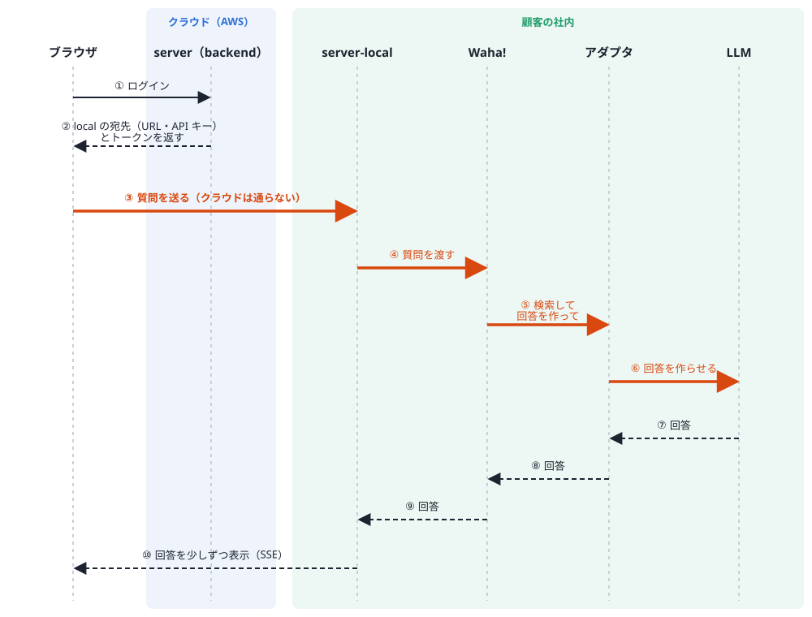
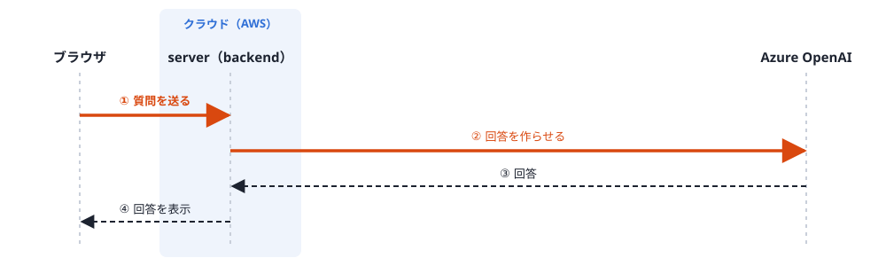

# naw-serverのfastapi化

# secuaigent-clientのnext.js化

## Codex 運用

`Codex` 用のプロジェクト運用ルールはルートの [AGENTS.md](./AGENTS.md) を参照してください。

## アシスタントの種類ごとの通信経路

アシスタントには、クラウドで処理する普通のアシスタント（`SAAS_CHAT`・`SAAS_RAG`）と、顧客の社内で処理する SECURE アシスタントがある。SECURE アシスタントは、質問や社内文書を社外に出さないためのもので、**質問はクラウドの server を通らず、ブラウザから社内の server-local に直接送られる**。クラウドの server は、送り先（server-local の URL と API キー）をブラウザに教えるだけで、server-local に通信しない。

以下は移植元（`secuaigent` モノレポ）のコードから書き起こした経路。

### SECURE アシスタント



オレンジの矢印が、質問の本文が流れる通信。青の区画がクラウド、緑の区画が顧客の社内。

- ②: クラウドの server は、テナントに登録された `LOCAL_SERVER` エンドポイントの URL と API キーを返す（移植元 `server` の `GetMessagesViewModel.java`）。SECURE アシスタントの質問を server に送ると 400 になる（`MessageService.java`）
- ③: ブラウザは受け取った URL に `api/messages/content` を付けて、server-local に直接送る（移植元 `client` の `message-content-endpoint.resolver.ts`・`messages.service.ts` の `prepareSecureStreamContext`）
- ④: server-local は、Waha! の HTTP API（`WahaServer/servicerun/api`）で入力を渡し、ワークフローを実行して結果を受け取る（`server-local/app/clients/waha_client.py`）
- ⑥: アダプタは LLM を直接呼ぶ。設定によっては、LLM の代わりにクラウドの server（`/auth/login-key` でログインし `/api/llm/chat`）を呼ぶ（移植元 `generative-ai-adapter` の `SecuAiGentAuthClient.java`・`SecuAiGentTransport.java`）
- このほか、ライブラリを作るときだけ server-local からクラウドの server を呼ぶ（`NawApiClient`）。クラウドから server-local へ向かう通信はない

### 普通のアシスタント（SAAS_CHAT・SAAS_RAG）



### 部品ごとの担当

| 部品 | 置き場所 | 担当 | このリポジトリ |
|---|---|---|---|
| server | クラウド | ユーザー・テナント・アシスタントの管理、普通のアシスタントのチャット。SECURE には送り先を教えるだけ | `backend/` |
| server-local | 顧客の社内 | SECURE の窓口。質問・学習ファイルを受け取って Waha! に渡し、結果を返す。会話と学習ファイルの記録を持つ | `server-local/` |
| Waha! | 顧客の社内 | ユニリタの ETL 製品。LLM に渡すまでのワークフロー（エージェント）を Waha! の中で組み立てて実行する。ワークフローは Waha! 側の設定で、どちらのリポジトリにもない | 対象外（製品） |
| アダプタ | 顧客の社内（Waha! に組み込む） | ワークフローの各ステップ。文書の分割・保存（埋め込み）、検索、回答作成（生成AI）。Waha! の `Adapter` インタフェース（`WTAddinAPI.jar`）を実装した Java の部品 | 未移植（`generative-ai-adapter/` の移植は要件定義中） |

## モノレポ構成

| ディレクトリ | 内容 |
|---|---|
| `backend/` | FastAPI（移植元 `server/` の移植先） |
| `frontend/` | React（Vite + React Router。移植元 `client/` の移植先） |
| `server-local/` | FastAPI + SQLite（移植元 `secuaigent-server-local/` の移植先） |
| `e2e-explorer/` | Playwright（TypeScript）の E2E 探索ハーネス。画面操作を再帰的にたどり、500・画面の例外・真っ白・表示崩れなどの「バグの疑い」を再現手順付きで一覧にする（移植元にはない独自のもの） |
| `infra/` | Terraform（AWS インフラ定義） |

## E2E 探索ハーネス（e2e-explorer）

専用の使い捨て環境（docker compose。既存のローカル環境とは名前・ポートが別）で frontend・backend を起動し、権限ごとにログインして画面を自動で巡回し、バグの疑いをレポートにする。

```bash
cd e2e-explorer
npm ci && npm run install:browsers
npm run explore:all   # 起動 → 巡回 → レポート → 破棄
```

何を見つけられて何を見つけられないか・担当範囲の分け方・レポートの読み方は [e2e-explorer/README.md](e2e-explorer/README.md)、レポートの仕分け（Issue の文案づくり）は `.claude/skills/e2e-explorer-triage/SKILL.md` を参照。

## ローカル疎通確認（frontend + backend）

React（`frontend/`）を起動し、ローカルの FastAPI バックエンドと接続して動作確認する手順。
backend の動作確認は、自動テスト（`cd backend && uv run pytest`）、または React の移植済み画面で行う。

> `secuaigent/client` のコピーだった `frontend-angular/` は Issue #213 で削除した。

### 前提


| 項目      | 値                                                                  |
| ------- | ------------------------------------------------------------------ |
| フロントエンド | `http://localhost:5173/`（Vite 開発サーバー）                                  |
| バックエンド  | `http://localhost:8001`（フロントは `VITE_API_URL` の URL を直接呼ぶ）                 |
| テナント ID | `test-tenant`（`backend/seed.sql` のシードテナント）                              |
| ログイン    | `admin` / `admin@1234`（`backend/seed.sql` のシードユーザー）                     |


> **現状の制約**: backend の `POST /auth/login`・`GET /api/auth` は `X-Tenant-ID` ヘッダ必須だが、React のログイン画面にはまだテナントID入力欄がない（ログイン後に `GET /api/auth` のレスポンスからテナントIDを得る作りだが、そのリクエスト自体が `X-Tenant-ID` 必須で、レスポンスに `tenant_id` もないため成り立たない）。入力欄を移植するまでは、React の画面からはログインできない。それまでは下の「バックエンド単体」の手順や自動テストで確認する。


### 初回セットアップ

```bash
# 1. DB 起動
docker compose up -d

# 2. バックエンドの依存関係・DB マイグレーション
cd backend
uv sync
cp .env.example .env   # 未作成の場合
alembic upgrade head

# 3. シードデータ投入
docker exec -i naw-fastapi-postgres psql -U root -d postgres < seed.sql

# 4. frontend の依存関係
cd ../frontend
npm install
```


### 起動

ターミナルを2つ使う。

```bash
# ターミナル1: バックエンド（ポート 8001）
cd backend
uv run uvicorn app.main:app --reload --port 8001
```

```bash
# ターミナル2: フロントエンド（ポート 5173）
# git 管理の frontend/.env は VITE_API_URL=http://localhost:8000 のため、環境変数で 8001 に上書きする
cd frontend
VITE_API_URL=http://localhost:8001 npm run dev
```


### 疎通確認


#### 1. バックエンド単体（任意）

```bash
curl -s -i -X POST http://localhost:8001/auth/login \
  -H "Content-Type: application/json" \
  -H "X-Tenant-ID: test-tenant" \
  -d '{"username":"admin","password":"admin@1234"}'
```

`HTTP/1.1 200 OK` と JWT / Cookie が返ればバックエンドは起動できている。

#### 2. ブラウザでフロントエンド経由

1. `http://localhost:5173/` を開く
2. ログイン画面（`/auth/login`）が表示されることを確認
3. ログイン以降の確認は、ログイン画面のテナントID入力欄の移植後に行う（上記「現状の制約」を参照）

#### トラブルシュート


| 症状       | 確認すること                                                                     |
| -------- | -------------------------------------------------------------------------- |
| 接続拒否     | バックエンドが **8001** で起動しているか、`VITE_API_URL=http://localhost:8001` を付けて起動したか   |
| CORS エラー | `backend/.env` の `CORS_ALLOWED_ORIGINS` に `http://localhost:5173` が含まれているか |
| DB エラー   | `docker compose up -d` で DB が起動しているか、`alembic upgrade head` 済みか、`seed.sql` が投入済みか |
