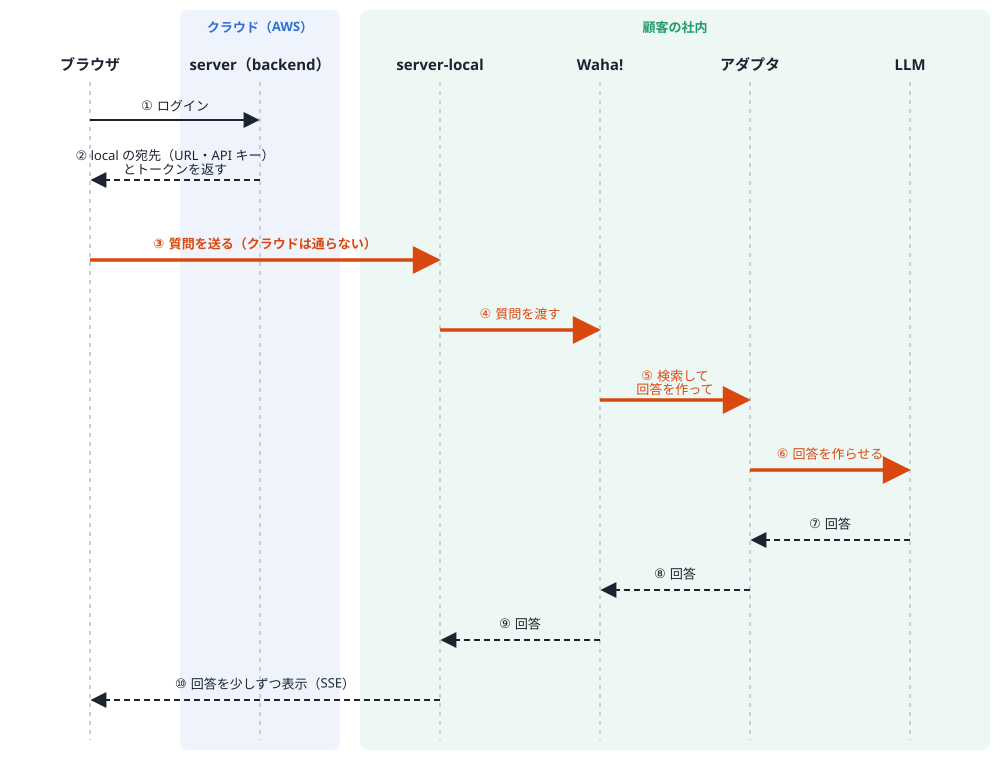
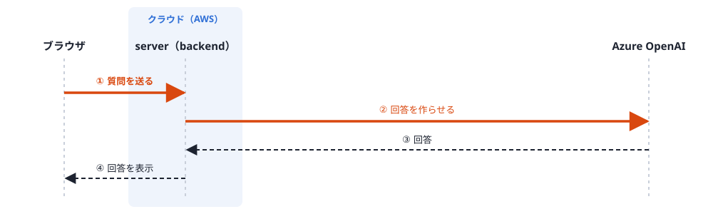

# アシスタントの種類ごとの通信経路

アシスタントには、クラウドで処理する普通のアシスタント（`SAAS_CHAT`・`SAAS_RAG`）と、顧客の社内で処理する SECURE アシスタントがある。SECURE アシスタントは、質問や社内文書を社外に出さないためのもので、**質問はクラウドの server を通らず、ブラウザから社内の server-local に直接送られる**。クラウドの server は、送り先（server-local の URL と API キー）をブラウザに教えるだけで、server-local に通信しない。

以下は移植元（`secuaigent` モノレポ）のコードから書き起こした経路。

## SECURE アシスタント

オレンジの矢印が、質問の本文が流れる通信。青の区画がクラウド、緑の区画が顧客の社内。

- ②: クラウドの server は、テナントに登録された `LOCAL_SERVER` エンドポイントの URL と API キーを返す（移植元 `server` の `GetMessagesViewModel.java`）。SECURE アシスタントの質問を server に送ると 400 になる（`MessageService.java`）
- ③: ブラウザは受け取った URL に `api/messages/content` を付けて、server-local に直接送る（移植元 `client` の `message-content-endpoint.resolver.ts`・`messages.service.ts` の `prepareSecureStreamContext`）
- ④: server-local は、Waha! の HTTP API（`WahaServer/servicerun/api`）で入力を渡し、ワークフローを実行して結果を受け取る（`secuaigent-server-local/app/clients/waha_client.py`）
- ⑥: アダプタは LLM を直接呼ぶ。設定によっては、LLM の代わりにクラウドの server（`/auth/login-key` でログインし `/api/llm/chat`）を呼ぶ（移植元 `generative-ai-adapter` の `SecuAiGentAuthClient.java`・`SecuAiGentTransport.java`）
- このほか、ライブラリを作るときだけ server-local からクラウドの server を呼ぶ（`NawApiClient`）。クラウドから server-local へ向かう通信はない

## 普通のアシスタント（SAAS_CHAT・SAAS_RAG）

## 部品ごとの担当

| 部品 | 置き場所 | 担当 | このリポジトリ |
|---|---|---|---|
| server | クラウド | ユーザー・テナント・アシスタントの管理、普通のアシスタントのチャット。SECURE には送り先を教えるだけ | `server/` |
| server-local | 顧客の社内 | SECURE の窓口。質問・学習ファイルを受け取って Waha! に渡し、結果を返す。会話と学習ファイルの記録を持つ | `secuaigent-server-local/` |
| Waha! | 顧客の社内 | ユニリタの ETL 製品。LLM に渡すまでのワークフロー（エージェント）を Waha! の中で組み立てて実行する。ワークフローは Waha! 側の設定で、どちらのリポジトリにもない | 製品は対象外。代わりに同じ API を持つ `waha-emulator/` を置く（[waha-emulator/README.md](../waha-emulator/README.md)） |
| アダプタ | 顧客の社内（Waha! に組み込む） | ワークフローの各ステップ。文書の分割・保存（埋め込み）、検索、回答作成（生成AI）。Waha! の `Adapter` インタフェース（`WTAddinAPI.jar`）を実装した Java の部品 | `generative-ai-adapter/` の生成AI・検索・埋め込みの 3 つのアダプタを移植済み（#298・#299・#300。[generative-ai-adapter/README.md](../generative-ai-adapter/README.md)） |
