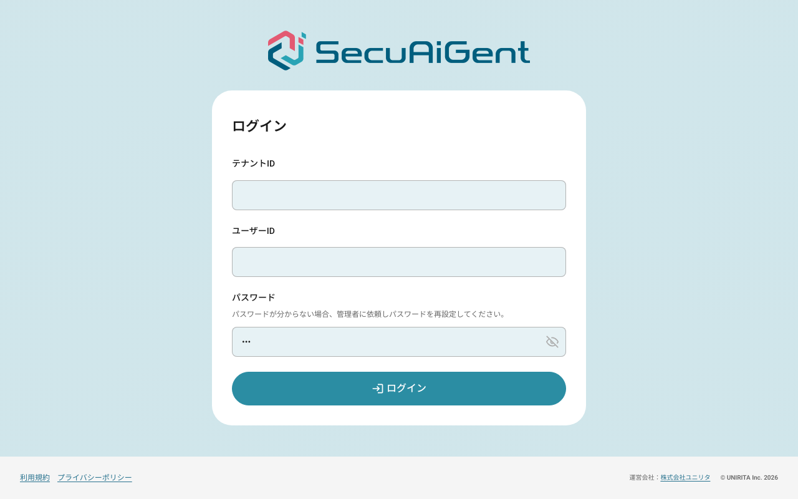

# 08_動作確認

ブラウザでの人手の確認は行わず、ハーネス自体は単体テスト（テスト用サイト）で、今の `frontend/` に対する巡回は専用環境で 1 コマンドを実際に流して確認した。以下はすべて実際の出力。

## 確認環境

- macOS（Darwin 27.2）、Docker 29.8.2・compose v5.5.0、Node.js v24.15.0
- Playwright 1.64.1（Chromium headless shell）、@axe-core/playwright 4.14.0
- 対象: このブランチ時点の `frontend/`・`backend/`（専用環境のコンテナで動かす）
- 既存のローカル環境（`naw-fastapi-postgres`・`naw-fastapi-redis`・`naw-postgres` など）は停止したまま触れていない（下記 3）

## 確認手順

1. `cd e2e-explorer && npm run lint && npm run typecheck && npm test`
2. `npm run explore:all -- --out reports/final`（専用環境の起動 → マイグレーション・seed・担当範囲ごとのテナント作成 → 全担当範囲を並列 4 で巡回 → まとめ → 破棄）
3. 巡回の前後で `docker ps -a` を見て、既存のコンテナが変わっていないこと・専用環境のコンテナが破棄されたことを確かめる
4. 途中で `npm run env:up` を単独で流し、担当範囲ごとのテナントとユーザーが入ったことを DB で確かめる（下記 4）

## 確認結果

### 1. lint・型チェック・単体テスト

develop（#276・#304・#305・#306）を取り込み、担当範囲の見直しと仮画面の除外を入れた後の結果。

```
> naw-e2e-explorer@0.1.0 lint
> eslint . --max-warnings 0


> naw-e2e-explorer@0.1.0 typecheck
> tsc --noEmit


> naw-e2e-explorer@0.1.0 test
> playwright test


Running 49 tests using 5 workers

  ✓   1 tests/config.test.ts:63:1 › keeps tenant ids within 32 characters (4ms)
  ✓   2 tests/config.test.ts:15:1 › expands groups and roles into shards (6ms)
  ✓   5 tests/config.test.ts:73:1 › applies cli overrides and validates them (7ms)
  ✓   4 tests/config.test.ts:53:1 › rejects non-local targets unless explicitly allowed (8ms)
  ✓   3 tests/config.test.ts:42:1 › selects shards by id and rejects unknown ids (9ms)
  ✓  10 tests/crawler.test.ts:84:1 › submits boundary and abnormal values (5.3s)
  ✓   6 tests/crawler.test.ts:64:1 › respects depth and action limits (7.5s)
  ✓  12 tests/crawler.test.ts:108:1 › logs in through the login page and stays logged in on new tabs (5.1s)
  ✓  13 tests/crawler.test.ts:122:1 › logs in again after a logout action and keeps crawling (5.0s)
  ✓  14 tests/crawler.test.ts:137:1 › keeps findings that happened before an action failed (4.1s)
  ✓   7 tests/crawler.test.ts:57:1 › visits the same state only once (22.6s)
  ✓   8 tests/crawler.test.ts:37:1 › crawls recursively and finds suspicions on every page (22.8s)
  ✓  16 tests/crawler.test.ts:159:1 › counts placeholder states and does not report them as no effect (1.2s)
  ✓  18 tests/crawler.test.ts:178:1 › shares explored common regions between shards (1.2s)
  ✓  19 tests/crawler.test.ts:199:1 › stops the shard with an error when the start page cannot be opened (98ms)
  ✓  20 tests/inputs.test.ts:11:1 › generates boundary values from maxlength (1ms)
  ✓  21 tests/inputs.test.ts:23:1 › uses numeric values for number inputs (1ms)
  ✓  22 tests/inputs.test.ts:33:1 › picks select options and mixes kinds deterministically (0ms)
  ✓  23 tests/inputs.test.ts:42:1 › shuffles deterministically by seed (0ms)
  ✓  24 tests/inputs.test.ts:50:1 › builds idempotent tenant provisioning sql (1ms)
  ✓  25 tests/inputs.test.ts:68:1 › skips tenant creation when shards reuse the source tenant (0ms)
  ✓  26 tests/oracle.test.ts:38:1 › detects 5xx responses as high severity (512ms)
  ✓  27 tests/oracle.test.ts:48:1 › detects unexpected 4xx separately from 5xx (507ms)
  ✓  28 tests/oracle.test.ts:57:1 › ignores 4xx declared as expected (509ms)
  ✓  11 tests/crawler.test.ts:100:1 › records out-of-scope navigation without exploring it (21.5s)
  ✓  17 tests/crawler.test.ts:170:1 › skips external links and excluded elements (4.3s)
  ✓  31 tests/oracle.test.ts:95:1 › detects horizontal overflow and protruding elements (233ms)
  ✓  29 tests/oracle.test.ts:66:1 › treats 4xx right after abnormal input as expected (810ms)
  ✓  30 tests/oracle.test.ts:77:1 › detects console errors, uncaught exceptions and unhandled rejections (810ms)
  ✓  32 tests/oracle.test.ts:104:1 › reports no layout issue on a normal page (240ms)
  ✓  33 tests/oracle.test.ts:112:1 › detects blank screen (406ms)
  ✓  35 tests/oracle.test.ts:131:1 › ignores focus-only style changes when judging no effect (397ms)
  ✓  34 tests/oracle.test.ts:120:1 › detects actions with no effect (736ms)
  ✓  37 tests/oracle.test.ts:155:1 › does not flag submits blocked by native validation (365ms)
  ✓  36 tests/oracle.test.ts:142:1 › does not judge placeholder screens as no effect (467ms)
  ✓  40 tests/oracle.test.ts:182:1 › detects dead ends (422ms)
  ✓  41 tests/report.test.ts:53:1 › merges findings with the same fingerprint across shards (1ms)
  ✓  42 tests/report.test.ts:77:1 › normalizes ids and numbers in fingerprints (0ms)
  ✓  43 tests/report.test.ts:87:1 › writes json, markdown and escaped html (3ms)
  ✓  44 tests/report.test.ts:103:1 › writes an empty report when nothing is found (3ms)
  ✓  39 tests/oracle.test.ts:174:1 › detects accessibility violations with axe (556ms)
  ✓  46 tests/shared-registry.test.ts:22:1 › records different keys independently (6ms)
  ✓  47 tests/shared-registry.test.ts:31:1 › removes a stale lock (29ms)
  ✓  48 tests/shared-registry.test.ts:45:1 › waits for a fresh lock instead of breaking it (205ms)
  ✓  49 tests/shared-registry.test.ts:59:1 › releases keys so that a rerun of the same shard explores them again (32ms)
  ✓  45 tests/shared-registry.test.ts:9:1 › grants a key to exactly one claimant under contention (493ms)
  ✓  38 tests/oracle.test.ts:166:1 › detects slow responses (1.2s)
  ✓  15 tests/crawler.test.ts:148:1 › does not report every action as slow on a polling page (15.6s)
  ✓   9 tests/crawler.test.ts:74:1 › crawls in the same order for the same seed (1.1m)

  49 passed (1.1m)
```

✅ lint・型チェックが通り、単体テスト 49 件がすべて通った（判定役・巡回役・調査済みの一覧・レポート・設定・入力値。仮画面の扱いのテスト 2 件を含む）

### 2. 1 コマンドでの巡回（取り込み後の frontend）

develop の取り込み後（全画面のルート・権限ガード・サイドバー・PW リセットのパス変更が入った `frontend/`）で、担当範囲を新しいルートに合わせて見直し、`npm run explore:all -- --out reports/final` を実行した。

ログ（docker compose のビルドの出力を除く）:

```
> node src/cli.ts run --out reports/final
02:24:03 専用環境を起動します（PostgreSQL・Redis・マイグレーション・seed・backend・frontend）
02:24:21 応答あり: http://localhost:58000/health
02:24:21 応答あり: http://localhost:55173
02:24:21 担当範囲ごとのテナントを作ります: e2e-account-admin, e2e-account-user, e2e-chat-admin, e2e-chat-user, e2e-library-admin, e2e-library-user, e2e-legacy-admin-admin, e2e-legacy-admin-user, e2e-admin-people-admin, e2e-admin-people-user, e2e-admin-assistants-admin, e2e-admin-history-admin, e2e-admin-tenant-admin
02:24:21 巡回を始めます: auth-anonymous, account-anonymous, account-admin, account-user, chat-admin, chat-user, library-admin, library-user, legacy-admin-admin, legacy-admin-user, admin-people-admin, admin-people-user, admin-assistants-admin, admin-history-admin, admin-tenant-admin（並列数 4・種 1）
02:24:21 出力先: /Users/pcm23005/Documents/personal/naw-server-fastapi-nextjs/.claude/worktrees/agent-af3bd4eaa5a44d444/e2e-explorer/reports/final
02:24:22 ワーカー 1: auth-anonymous を開始
02:24:22 ワーカー 2: account-anonymous を開始
02:24:22 ワーカー 3: account-admin を開始
02:24:22 ワーカー 4: account-user を開始
02:24:23 [account-admin] ログインしました（テナント e2e-account-admin）
02:24:23 [account-user] ログインしました（テナント e2e-account-user）
02:25:02 ワーカー 1: auth-anonymous を終了（状態 2・操作 22・疑い 2）
02:25:02 ワーカー 1: chat-admin を開始
02:25:03 [chat-admin] ログインしました（テナント e2e-chat-admin）
02:25:37 [chat-admin] ログインしました（テナント e2e-chat-admin）
02:25:39 ワーカー 1: chat-admin を終了（状態 4・操作 14・疑い 3）
02:25:39 ワーカー 1: chat-user を開始
02:25:40 [chat-user] ログインしました（テナント e2e-chat-user）
02:25:42 ワーカー 1: chat-user を終了（状態 1・操作 0・疑い 1）
02:25:42 ワーカー 1: library-admin を開始
02:25:43 [library-admin] ログインしました（テナント e2e-library-admin）
02:25:45 ワーカー 1: library-admin を終了（状態 1・操作 0・疑い 1）
02:25:45 ワーカー 1: library-user を開始
02:25:46 [library-user] ログインしました（テナント e2e-library-user）
02:25:48 ワーカー 1: library-user を終了（状態 1・操作 0・疑い 1）
02:25:48 ワーカー 1: legacy-admin-admin を開始
02:25:49 [legacy-admin-admin] ログインしました（テナント e2e-legacy-admin-admin）
02:25:52 ワーカー 1: legacy-admin-admin を終了（状態 1・操作 0・疑い 1）
02:25:52 ワーカー 1: legacy-admin-user を開始
02:25:53 [legacy-admin-user] ログインしました（テナント e2e-legacy-admin-user）
02:25:57 ワーカー 1: legacy-admin-user を終了（状態 1・操作 0・疑い 1）
02:25:57 ワーカー 1: admin-people-admin を開始
02:25:58 [admin-people-admin] ログインしました（テナント e2e-admin-people-admin）
02:26:18 ワーカー 1: admin-people-admin を終了（状態 2・操作 8・疑い 2）
02:26:18 ワーカー 1: admin-people-user を開始
02:26:18 [admin-people-user] ログインしました（テナント e2e-admin-people-user）
02:26:20 ワーカー 1: admin-people-user を終了（状態 1・操作 0・疑い 1）
02:26:20 ワーカー 1: admin-assistants-admin を開始
02:26:21 [admin-assistants-admin] ログインしました（テナント e2e-admin-assistants-admin）
02:26:23 ワーカー 1: admin-assistants-admin を終了（状態 1・操作 0・疑い 1）
02:26:23 ワーカー 1: admin-history-admin を開始
02:26:24 [admin-history-admin] ログインしました（テナント e2e-admin-history-admin）
02:26:25 ワーカー 1: admin-history-admin を終了（状態 1・操作 0・疑い 1）
02:26:25 ワーカー 1: admin-tenant-admin を開始
02:26:26 [admin-tenant-admin] ログインしました（テナント e2e-admin-tenant-admin）
02:26:28 ワーカー 1: admin-tenant-admin を終了（状態 1・操作 0・疑い 1）
02:28:12 ワーカー 2: account-anonymous を終了（状態 8・操作 104・疑い 0）
02:28:13 ワーカー 4: account-user を終了（状態 8・操作 104・疑い 0）
02:28:13 ワーカー 3: account-admin を終了（状態 8・操作 104・疑い 0）
02:28:15 疑い 3 件（発生 16 回 / 高 0・中 2・低 1）
02:28:15 レポート: /Users/pcm23005/Documents/personal/naw-server-fastapi-nextjs/.claude/worktrees/agent-af3bd4eaa5a44d444/e2e-explorer/reports/final/report.md
02:28:15          /Users/pcm23005/Documents/personal/naw-server-fastapi-nextjs/.claude/worktrees/agent-af3bd4eaa5a44d444/e2e-explorer/reports/final/report.html
02:28:15          /Users/pcm23005/Documents/personal/naw-server-fastapi-nextjs/.claude/worktrees/agent-af3bd4eaa5a44d444/e2e-explorer/reports/final/report.json
02:28:15 専用環境を破棄します（データごと）
```

レポート（`e2e-explorer/reports/final/report.md` の抜粋。レポートは git 管理外）:

#### 担当範囲

| 担当範囲 | 権限 | テナント | 状態 | 仮画面 | 操作 | 共有で飛ばした | 担当外 | 再生失敗 | 時間 | 終了理由 |
|---|---|---|---|---|---|---|---|---|---|---|
| account-admin | admin | e2e-account-admin | 8 | 0 | 104 | 0 | 0 | 0 | 232s | queue-empty |
| account-anonymous | anonymous | - | 8 | 0 | 104 | 0 | 0 | 0 | 231s | queue-empty |
| account-user | user | e2e-account-user | 8 | 0 | 104 | 0 | 0 | 0 | 231s | queue-empty |
| admin-assistants-admin | admin | e2e-admin-assistants-admin | 1 | 1 | 0 | 11 | 0 | 0 | 2s | queue-empty |
| admin-history-admin | admin | e2e-admin-history-admin | 1 | 1 | 0 | 11 | 0 | 0 | 3s | queue-empty |
| admin-people-admin | admin | e2e-admin-people-admin | 2 | 2 | 8 | 14 | 6 | 0 | 21s | queue-empty |
| admin-people-user | user | e2e-admin-people-user | 1 | 1 | 0 | 9 | 0 | 0 | 3s | queue-empty |
| admin-tenant-admin | admin | e2e-admin-tenant-admin | 1 | 1 | 0 | 11 | 0 | 0 | 3s | queue-empty |
| auth-anonymous | anonymous | - | 2 | 0 | 22 | 0 | 0 | 0 | 40s | queue-empty |
| chat-admin | admin | e2e-chat-admin | 4 | 4 | 14 | 24 | 4 | 0 | 37s | queue-empty |
| chat-user | user | e2e-chat-user | 1 | 1 | 0 | 9 | 0 | 0 | 3s | queue-empty |
| legacy-admin-admin | admin | e2e-legacy-admin-admin | 1 | 1 | 0 | 9 | 0 | 0 | 4s | queue-empty |
| legacy-admin-user | user | e2e-legacy-admin-user | 1 | 0 | 0 | 9 | 0 | 0 | 5s | queue-empty |
| library-admin | admin | e2e-library-admin | 1 | 1 | 0 | 9 | 0 | 0 | 3s | queue-empty |
| library-user | user | e2e-library-user | 1 | 1 | 0 | 9 | 0 | 0 | 3s | queue-empty |

#### 疑いの一覧

| # | 重大度 | 種類 | 場所 | 症状 | 回数 | 担当範囲 |
|---|---|---|---|---|---|---|
| 1 | 中 | アクセシビリティの違反 | [未移植の仮画面] [label-content-name-mismatch] | serious: Elements must have their visible text as part of their accessible name | 13 | admin-assistants-admin, admin-history-admin, admin-people-admin, admin-people-user, admin-tenant-admin, chat-admin, chat-user, legacy-admin-admin, library-admin, library-user |
| 2 | 中 | アクセシビリティの違反 | /users [label-content-name-mismatch] | serious: Elements must have their visible text as part of their accessible name | 1 | legacy-admin-user |
| 3 | 低 | 操作しても何も起きなかった | /auth/login | 画面の変化・遷移・通信・ダイアログのどれもなかった | 2 | auth-anonymous |

✅ 1 コマンドで、専用環境の起動 → 担当範囲 15（画面のまとまり 9 × 権限）の並列巡回 → レポート → 破棄まで動いた。15 とも終了理由は `queue-empty`

✅ 「未移植」の仮画面（`oracle.placeholderMarkers` = `未移植: `）に着いた状態は担当範囲の表の「仮画面」の列に数え、「操作しても何も起きない」「操作できる要素がない」・仮画面の文字のはみ出しは疑いにしていない。仮画面の表示崩れ・axe は場所を `[未移植の仮画面]` に 1 つにまとめた（疑い 1 は 10 の担当範囲・13 回の発生が 1 件になっている）

✅ 権限ガードの動き: 一般ユーザー（`user`）で `/admin/users` を開くと新規チャットへ戻され（`admin-people-user` は仮画面 1 つで終わる）、`/users` は何も表示されない（`legacy-admin-user` の「仮画面」0。移植元の adminGuard と同じ振る舞い）

✅ 既存のローカルのコンテナは変わらず、専用環境のコンテナは破棄された（`docker ps -a | grep e2e-explorer` が 0 件）

#### 取り込み後の巡回で見つけてハーネスを直したもの

- frontend が 4xx の API 応答を `console.error("[API] Forbidden: …")` で出すようになり、異常値を送ったときの想定内の 403 が、`account-*`・`auth-anonymous` で 125 回のコンソールエラーとして出ていた（初回の取り込み後の巡回。疑い 6 件・151 回）。HTTP の判定で既に想定内としている 4xx のログなので、`oracle.ignoreConsole` に `^\[API\] (Bad Request|Unauthorized|Forbidden|Unprocessable Entity|Too Many Requests):` を足した（5xx のログは無視しない）
- 仮画面の文字そのもの（`未移植: …`）がスマホ幅で枠からはみ出す疑いが出ていたため、仮画面では文字のはみ出しを見ないようにした

#### 出た疑い（3 件）と見立て

この Issue では直さない。見立ては移植元（`secuaigent-ref/client`）と照らした一次判断で、起票は仕分け（`.claude/skills/e2e-explorer-triage`）を通して人が判断する。

| # | 重大度 | 疑い | 見立て |
|---|---|---|---|
| 1 | 中 | 仮画面を含む管理レイアウトの全画面（`[未移植の仮画面]`）のサイドバーで axe の `label-content-name-mismatch`。10 の担当範囲・13 回 | バグの可能性が高い。サイドバーのユーザーメニューのボタンに `aria-label="user-menu"` が付いており、見えている文字（ユーザー名）がアクセシブルな名前に含まれない。移植元 `user-menu.component.html` のボタンには `aria-label` がない。#306 で入ったサイドバーでも続いている（初回の巡回で見つけた疑いと同じ原因） |
| 2 | 中 | `/users`（一般ユーザーで開いたとき）で同じ axe の違反 | 1 と同じ原因（同じユーザーメニューのボタン）。この画面は仮画面ではないため別の場所として出る |
| 3 | 低 | ログイン画面でテナント ID などを空白だけにして送信すると何も起きない（エラー表示もない）。2 回 | バグ（フィードバック漏れ）の可能性が高い。`login.tsx` の `handleSubmit` が、空白を除いたテナント ID が空なら何も表示せずに戻る。移植元は不正な入力で欄ごとのエラーを表示する。初回の巡回から変わらず |




（スクリーンショットは取り込み前の巡回のもの。同じ疑いが取り込み後も出ている）

### 3. 既存の環境に触れていないこと

巡回の前（`env:up` の直後）:

```
naw-e2e-explorer-frontend-1	Up 6 seconds (healthy)
naw-e2e-explorer-backend-1	Up 12 seconds (healthy)
naw-e2e-explorer-seed-1	Exited (0) 13 seconds ago
naw-e2e-explorer-migrate-1	Exited (0) 13 seconds ago
naw-e2e-explorer-postgres-1	Up 18 seconds (healthy)
naw-e2e-explorer-redis-1	Up 18 seconds (healthy)
naw-fastapi-frontend-angular	Exited (1) 2 months ago
naw-fastapi-backend	Exited (0) 2 months ago
naw-fastapi-postgres	Exited (0) 7 hours ago
naw-fastapi-redis	Exited (0) 7 hours ago
naw-fastapi-localstack	Exited (137) 2 months ago
naw-postgres	Exited (0) 7 hours ago
```

最後の `explore:all` の後の `docker ps -a --format '{{.Names}}' | grep e2e-explorer`: `専用環境のコンテナなし`（該当なし）

✅ 専用環境は別名（`naw-e2e-explorer-*`）・別ポート（127.0.0.1 の 55432・56379・58000・55173）で動き、終了時にデータごと破棄された。既存のコンテナは停止したまま変わっていない

### 4. 担当範囲ごとのテナント

`npm run env:up` の後の DB（取り込み前の担当範囲での確認。取り込み後は 13 のテナント・26 ユーザーが同じ方法で作られ、巡回のログインが通っている）:

```
      tenant_id      | login_id | role  | ph 
---------------------+----------+-------+----
 e2e-account-admin   | admin    | ADMIN |  1
 e2e-account-admin   | user01   | USER  |  1
 e2e-account-user    | admin    | ADMIN |  1
 e2e-account-user    | user01   | USER  |  1
 e2e-dashboard-admin | admin    | ADMIN |  1
 e2e-dashboard-admin | user01   | USER  |  1
 e2e-dashboard-user  | admin    | ADMIN |  1
 e2e-dashboard-user  | user01   | USER  |  1
(8 rows)
```

✅ ログインする担当範囲 4 つにそれぞれ専用テナントができ、seed の `admin`・`user01` とパスワード履歴が写った

### 5. 実装中に巡回で見つけて直したハーネスの不具合

- ログイン直後のアプリの画面ごとの遷移（`window.location.href`）中に sessionStorage を読んで失敗していた → 読み込みの完了を待って読み直すようにした
- 応答のない待ちで担当範囲が止まり続けることがあった → 時間の上限 + 60 秒で打ち切るウォッチドッグを入れた
- 入力欄のフォーカスが外れたときの見た目の切り替えを「操作で何かが起きた」と数えていた（空白だけのログインの送信を見逃していた）→ 見張りの前にフォーカスを外して再描画を待つようにし、単体テスト `ignores focus-only style changes when judging no effect` を足した

## 未確認事項

- この回は `account-user` で 1 件、再生の途中で「パスワードを表示」ボタンが見つからない再生失敗があった（同じ操作の列を再生しても、表示・非表示の切り替えの反映が間に合わず、ボタンの名前が変わる前に探した可能性がある）。疑いではなく、レポートの「再生失敗」に数えている。同じ設定の他の 2 回では起きていない

- 巡回の対象は今の `frontend/` の画面（ログイン・パスワード再設定・ダッシュボード）だけ。画面が増えたら `explorer.config.json` の `groups` を足す必要がある
- 専用テナントにはユーザーしか写していないため、データが要る画面（一覧など）の巡回は、写す範囲を広げる別 Issue で扱う
- 調査済みの一覧を使うと、共通領域をどの担当範囲が調べるかは実行のタイミングで変わる（担当範囲の分け方や実行のタイミングで、取る担当範囲が変わる）。完全な再現が要るときは `--no-shared-registry` で単独で流す（README に記載）
- CI での定期実行は対象外（別 Issue）
- `npm audit` で lint 用の開発依存（typescript-eslint・eslint の minimatch）に moderate の指摘がある。実行時には使わない依存で、修正版は eslint の大きな版下げ（`--force`）になるため見送った
