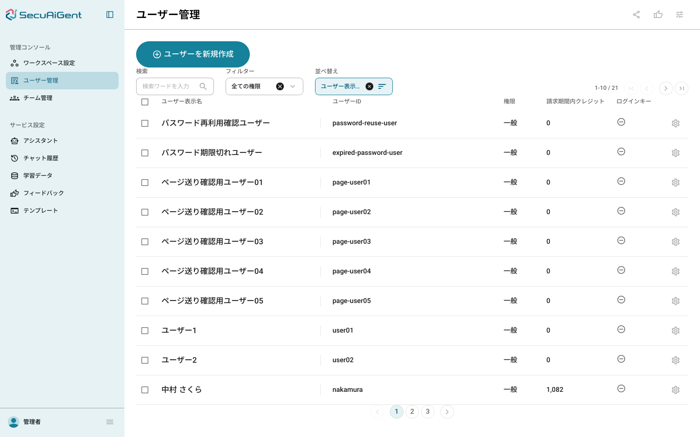
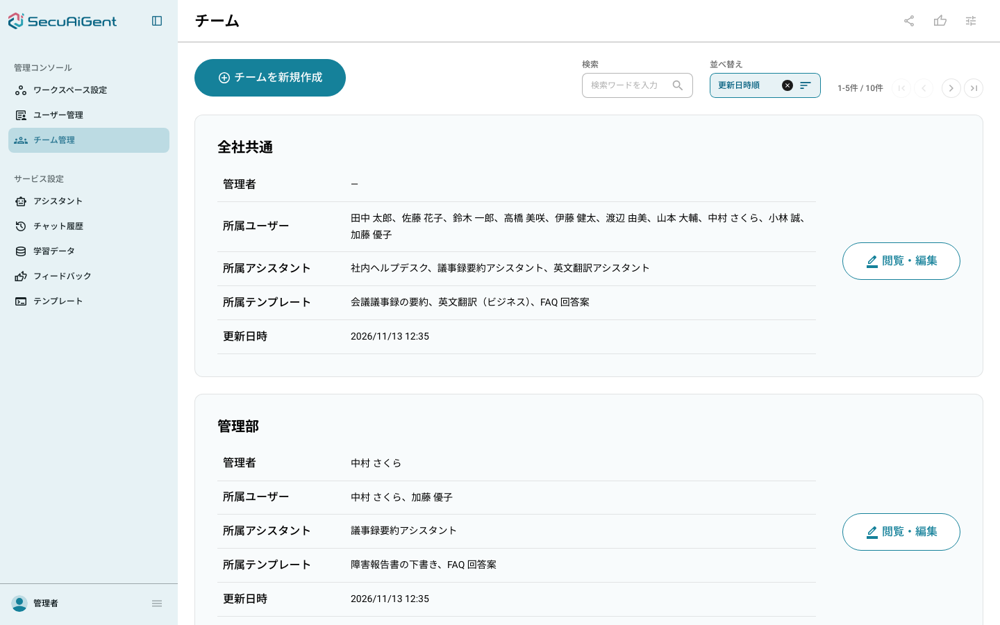
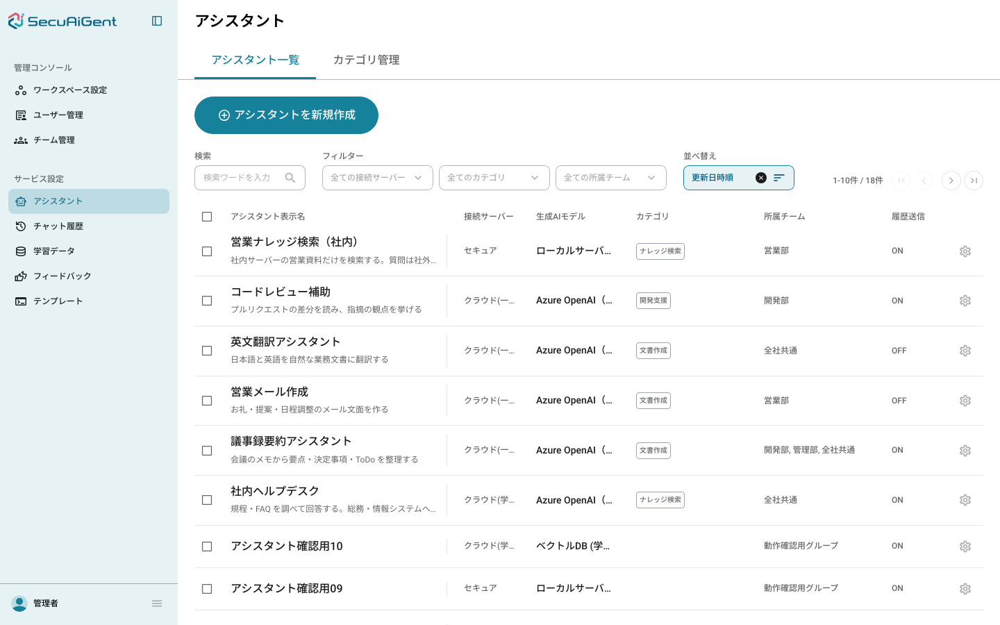
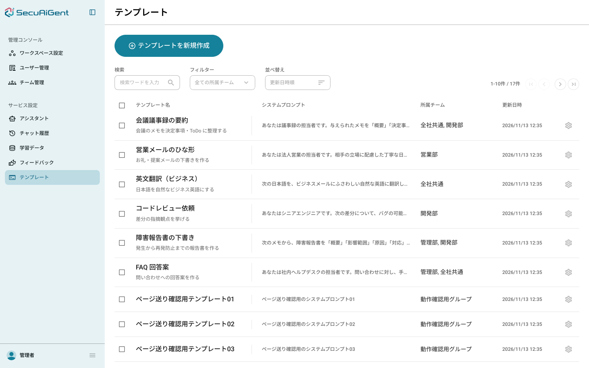
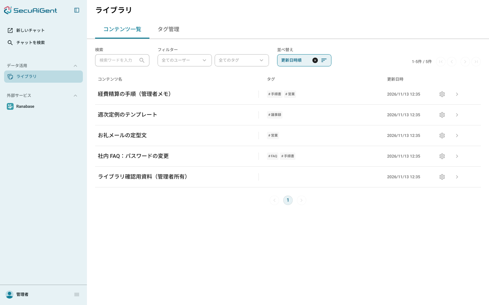
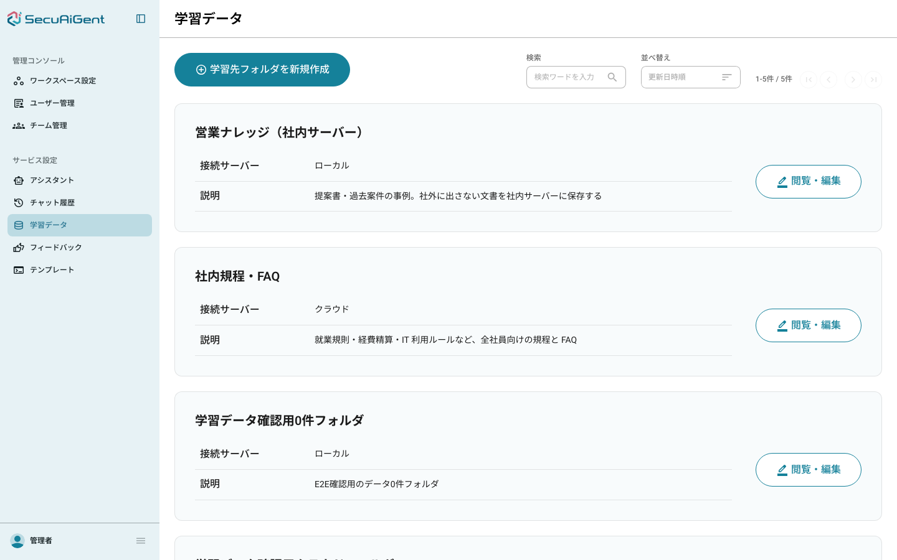
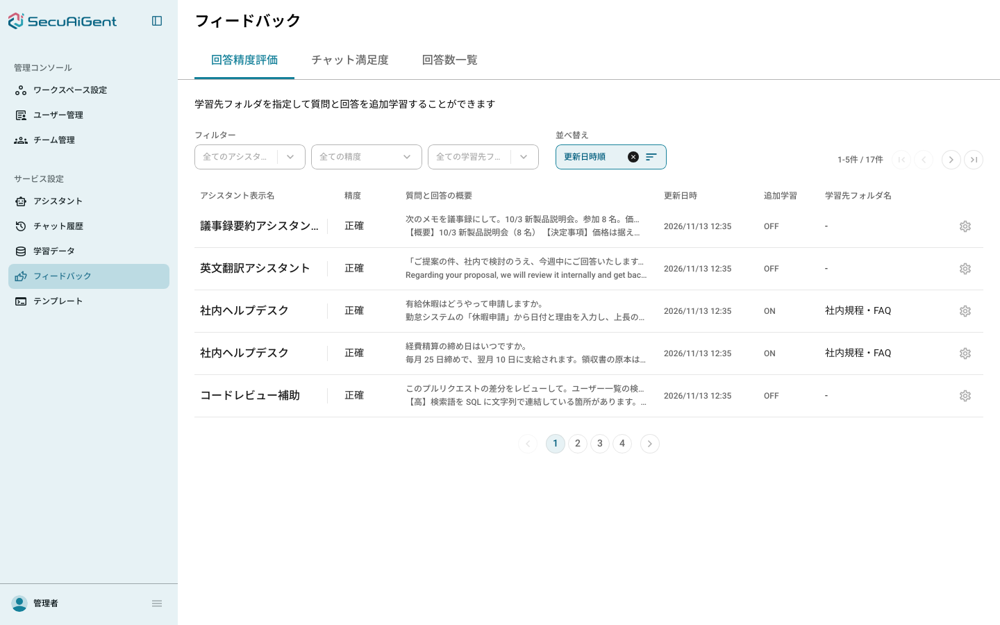
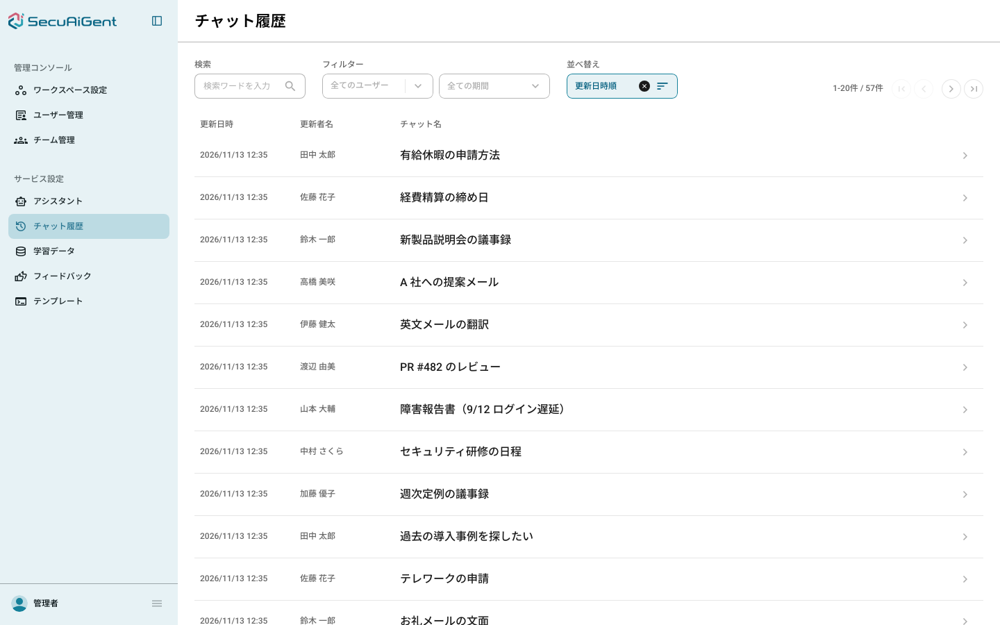
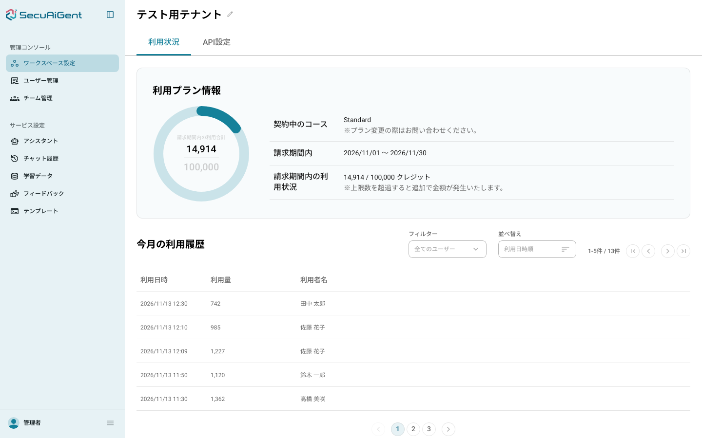

# 08_動作確認

## 確認環境

- 2026-11-13、macOS（Docker / Docker Compose）、Chromium（Playwright 1.64.1。`e2e-explorer/` の `node_modules` を使用）
- 既存のローカル環境（`naw-fastapi-*` のコンテナ、ポート 5433・6380・8001・5173）と衝突しないよう、別のポートで起動した

```bash
export DEMO_FRONTEND_PORT=15173 DEMO_BACKEND_PORT=18001
docker compose -f docker-compose.demo.yml up -d --build
```

## 確認手順

1. ボリュームのない状態から `up -d --build` で起動し、`ps -a` で状態を見る
2. `docker compose -f docker-compose.demo.yml run --rm seed` で seed をもう一度流し、件数が増えないことを見る
3. `onprem/cloud-seed.sql` をデモ環境の DB に流す
4. Playwright でログイン（テナント ID `test-tenant`・`admin` / `admin@1234`）し、管理画面 9 画面を開いてスクリーンショットを撮る
5. `down -v` で片付け、コンテナ・ボリューム・ネットワーク・イメージが残っていないことを見る

## 確認結果

### 1. 起動

起動までは約 20 秒（イメージのビルドキャッシュあり。初回はビルドに数分かかる）。`ps -a` の結果:

```
naw-demo-backend-1     Up 2 minutes (healthy)
naw-demo-frontend-1    Up 2 minutes (healthy)
naw-demo-localstack-1  Up 2 minutes (healthy)
naw-demo-migrate-1     Exited (0) 2 minutes ago
naw-demo-postgres-1    Up 2 minutes (healthy)
naw-demo-redis-1       Up 2 minutes (healthy)
naw-demo-seed-1        Exited (0) 2 minutes ago
```

`migrate`・`seed` が終了コード 0 で終わり、`backend`・`frontend` が healthy になった。

確認の途中で、既存の `backend/seed.sql` が `column "content" of relation "libraries" does not exist` で失敗することが分かった（#307 の後に未更新）。`libraries` と `library_contents` に分けて修正し、その後は最後まで通る。

### 2. seed の冪等

`seed` を再実行してもエラーにならず、再実行後の件数（`test-tenant`）は、再実行前に画面で見た件数と同じだった。

| 対象 | 件数 |
|---|---|
| users | 21 |
| groups | 10 |
| assistants | 18 |
| prompt_templates | 17 |
| libraries | 11 |
| files | 21 |
| message_feedbacks | 17 |
| rooms | 57 |
| token_usages | 13 |

### 3. onprem/cloud-seed.sql

デモ環境の DB に流して、エラーなく通った（`cloud-seed-ok`）。

### 4. ログインと管理画面 9 画面

テナント ID・ユーザー ID・パスワードでログインすると `/dashboard` に遷移した。各画面にデモデータが出ている。

ユーザー（`/admin/users`。社員 10 名を含む 21 名）



チーム（`/admin/groups`。所属ユーザー・アシスタント・テンプレート付き）



アシスタント（`/admin/assistants`。カテゴリ・所属チーム付き）



テンプレート（`/admin/templates`）



ライブラリ（`/library`。管理者の資料とタグ）



学習データ（`/admin/training-data`。クラウド・ローカルの学習先フォルダ）



フィードバック（`/admin/feedback`。回答精度評価）



チャット履歴（`/admin/chat-history`。デモのチャットが新しい順の先頭に並ぶ）



ワークスペース（`/admin/tenant`。クレジットの利用状況と利用履歴）



### 5. 片付け

`down -v --remove-orphans` のあと、`naw-demo` で始まるコンテナ・ボリューム・ネットワークは 0 件。ビルドしたイメージ（`naw-demo-frontend`・`naw-demo-backend`）も削除した。既存の `naw-fastapi-*` のコンテナには触れていない。

## 未確認事項

- ポートを既定（画面 5173・backend 8001）のままにした起動は確認していない。既存のローカル環境がその 2 つのポートを使っているため、別ポート（15173・18001）で確認した。既定ポートでも、`ports` と `CORS_ALLOWED_ORIGINS`・`VITE_API_URL` の既定値が同じ式で決まるだけで、挙動は変わらない
- `onprem/` を実際に起動して SECURE のチャットを通すところは確認していない（SQL が流れるところまで）。`onprem/` の起動と通しの確認は #301 の範囲
- 画面からの新しい質問の送信は確認していない（接続先がダミーのため、答えは返らない）
- チーム詳細・学習データ詳細などは、現時点で枠だけの画面（別 Issue の範囲）。一覧までを確認した
