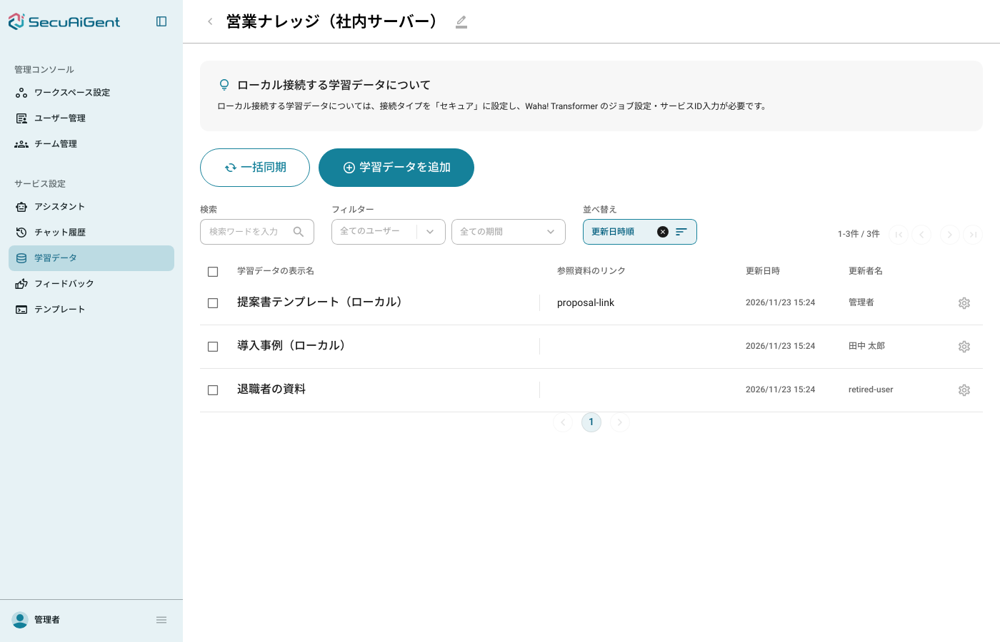
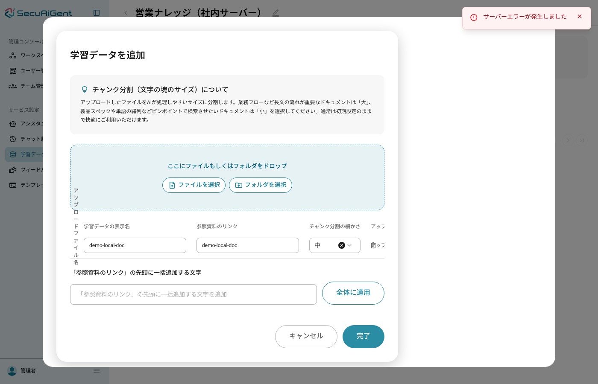

# 08_動作確認

## 確認環境

- ブランチ: `feature/issue-390-NAW-1340`（コミット 68bdb6b 時点のコード）
- デモ環境: `docker compose -f docker-compose.demo.yml`（`DEMO_FRONTEND_PORT=15173` `DEMO_BACKEND_PORT=18001`）。`server/seed-demo.sql` の更新で、ローカルのフォルダの接続先は `http://localhost:8090`、API キーは `demo-local-server-key`
- `server-local`: `docker compose up`（公開ポート 8090、`SECURITY_SERVER_AUTH_KEY=demo-local-server-key`）。Waha! は無い（`WAHA_URL` の先に接続できない）
- ブラウザ: Playwright（ヘッドレス Chromium）。`http://localhost:15173`、テナント `test-tenant`、ユーザー `admin`（デモデータのテスト用ログイン）
- ローカルのフォルダ: 「営業ナレッジ（社内サーバー）」。`server-local` の DB（SQLite）に、確認用のファイル 3 行（更新者は `admin`・`tanaka`・`retired-user`）を直接入れた

## 確認手順

1. ログインして、ローカルのフォルダの詳細を開く
2. 通信の先（クラウド `:18001` と `server-local` `:8090`）と、認証キーのヘッダーを記録する
3. 「学習データを追加」でファイルを 1 件追加する
4. 「一括同期」を押す

## 確認結果

### Step 1: 一覧

- 接続先は、操作のたびに `GET :18001/api/tenants/endpoints/local/{接続先 ID}`（クラウド）から取っていた
- 一覧は `GET :8090/api/admin/indexes/{id}/files?page=0&size=10`（`server-local`）へ、`X-Server-Auth-Key: demo-local-server-key` を付けて送られ、200 が返った
- クラウドのファイル一覧 API（`:18001/.../files`）は呼ばれなかった
- 一覧に `server-local` の 3 行が表示された。更新者は、`admin` が「管理者」、`tanaka` が「田中 太郎」に解決され、見つからない `retired-user` はログイン ID のまま出た

### Step 2: 追加

- 追加は `POST :8090/api/admin/indexes/{id}/files`（API キー付き）へ送られた。クラウドの API へは送られなかった
- `server-local` が Waha! に接続できず（`All connection attempts failed`）500 を返し、画面は「サーバーエラーが発生しました」を表示して、一覧を読み直した

### Step 3: 一括同期

- 3 秒待ってから `POST :8090/api/admin/indexes/{id}/sync`（API キー付き）へ送られた。同じく Waha! に接続できず 500 になった

## 未確認事項

- ファイルの追加・更新・削除・同期が、ローカル用サーバーで最後まで成功すること。これらは `server-local` が Waha!（のジョブ）を呼ぶため、Waha! が無い環境では 500 になる。送り先・ヘッダー・本文の組み立ては、`server-local` に届いたこと（上記）と自動テスト（`local-training-api.test.ts`）で確かめた
- 更新と削除は、ブラウザでは操作していない（追加と同期で、同じ接続先・認証の経路を確かめた。更新と削除の送り先と本文は自動テストで確かめた）
- 実際のローカル用サーバー（Java）との通信、https の画面から http の接続先を呼ぶときのブラウザの制約
- この確認で `server-local` の DB に入れた確認用の行は、デモの標準データではない
