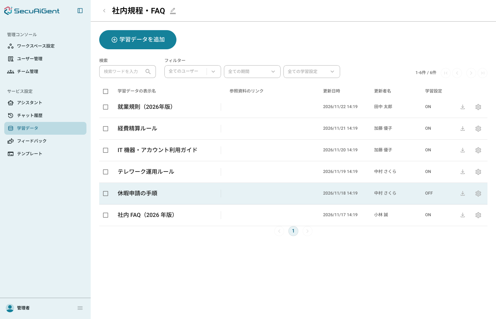
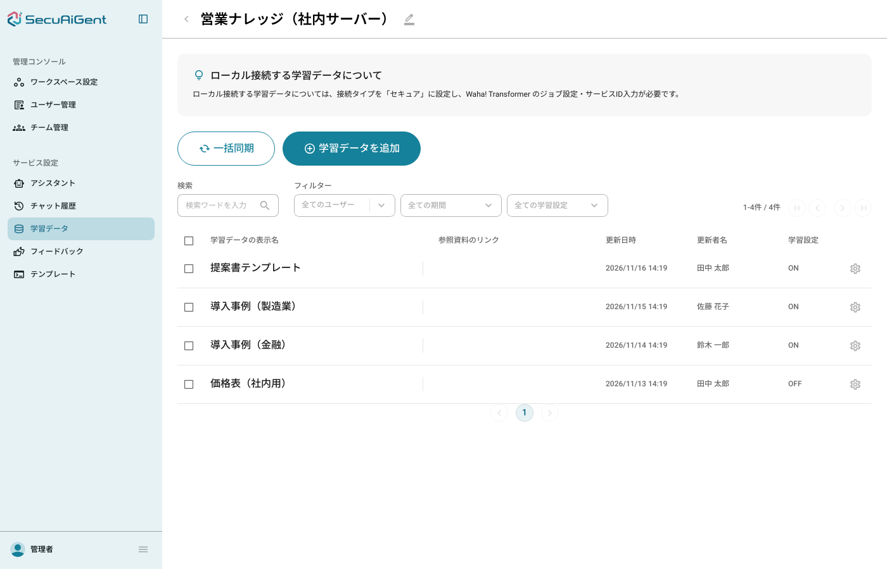

# 08_動作確認

## 確認環境

- ブランチ: `feature/issue-392-NAW-1427`（コミット a7dbfb6 時点のコード）
- デモ環境: `docker compose -f docker-compose.demo.yml`（`DEMO_FRONTEND_PORT=15173` `DEMO_BACKEND_PORT=18001`）
- ブラウザ: Playwright（ヘッドレス Chromium）。`http://localhost:15173`、テナント `test-tenant`、ユーザー `admin`（デモデータのテスト用ログイン）
- 備考: Chrome 拡張のタブはエラーページのままで使えなかったため、Playwright で確認した。`127.0.0.1` で開くと backend の CORS で弾かれ、ログインできなかった（`localhost` では通る）

## 確認手順

1. ログインして `/admin/training-data` を開く
2. クラウドのフォルダ「社内規程・FAQ」の詳細を開く
3. ローカルのフォルダ「営業ナレッジ（社内サーバー）」の詳細を開く
4. それぞれで、並べ替えの操作が出ないこと（`data-testid` が `training-data-file-sort` で始まる要素が 0 件、本文に「並べ替え」が無い）と、絞り込み領域の並びを確かめる

## 確認結果

### Step 1: クラウドのフォルダ詳細

- 並べ替えの `data-testid` は 0 件、本文に「並べ替え」は無かった
- 検索・フィルター（ユーザー・期間・学習設定）・件数・ページ送りは表示された
- 一覧は更新日時の新しい順（2026/11/22 → 2026/11/17）だった

### Step 2: ローカルのフォルダ詳細

- 並べ替えの `data-testid` は 0 件、本文に「並べ替え」は無かった
- 絞り込み領域の並びは崩れていない
- 一覧は更新日時の新しい順（2026/11/16 → 2026/11/13）だった

### Step 3: フォルダ一覧（スコープ外の画面）

- フォルダ一覧の並べ替え（更新日時順）は、これまでどおり残っていた（今回は変更しない）

## 未確認事項

- 並べ替えを外す前の画面との見た目の比較は撮っていない（変更前のコードでは、新規テスト `does not render a sort input` が失敗することで確認した）
- 一覧取得のリクエストに `sort=updatedAt,desc` が付くことは、ブラウザでは通信を直接見ていない（画面の並びで確認した）。画面のテスト（`training-data-detail.test.tsx` の初期の取得条件）が、この値を確かめている
- 全体テストで `chat-history-detail.test.tsx` の1件が、全体実行のときだけ失敗した。単独では変更前後とも通る。今回の変更とは無関係と見ている
- ローカルのフォルダで、デモデータの一覧が表示された。#390 に書いた「LOCAL フォルダの一覧は動かない見込み」は、デモ環境では当てはまらなかった。#390 の着手時に、一覧・追加・編集・削除のどれがどう動くかを確かめ直す
