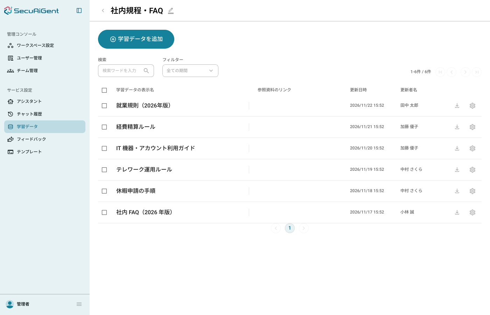

# 08_動作確認

## 確認環境

- ブランチ: `feature/issue-411-NAW-1424`（コミット 941b4ac 時点のコード）
- デモ環境: `docker compose -f docker-compose.demo.yml`（`DEMO_FRONTEND_PORT=25173` `DEMO_BACKEND_PORT=28001`）
- ブラウザ: Playwright（ヘッドレス Chromium）。`http://localhost:25173`、テナント `test-tenant`、ユーザー `admin`（デモデータのテスト用ログイン）
- 対象: クラウドのフォルダ「社内規程・FAQ」

## 確認手順

1. ログインして、クラウドのフォルダの詳細を開く
2. 更新者の絞り込みの要素（`data-testid` が `training-data-file-user` で始まるもの）と、「全てのユーザー」の文言を探す
3. 更新者の欄の表示を読む
4. この画面を開いている間の、ユーザー一覧 API（`/admin/users`）の呼び出しを数える

## 確認結果

- 更新者の絞り込みの要素は 0 件で、「全てのユーザー」の文言も無かった。検索と期間（「全ての期間」）だけが出ていた
- 更新者の欄は、API が返す名前が出た（田中 太郎・加藤 優子・中村 さくら・小林 誠）
- この画面でのユーザー一覧 API（`/admin/users`）の呼び出しは 0 件だった（これまでは全ユーザー最大 1000 件を取っていた）

## 未確認事項

- 「削除されたユーザー」と「Unknown」の表示は、画面のテスト（`training-data-detail.test.tsx`）と単体テストで確かめた。デモデータに該当するファイルが無いため、ブラウザでは確認していない
- ローカルのフォルダは、ブラウザでは確認していない（`server-local` を起動していない）。ログイン ID での名前の検索は #390 の動作のままで、画面のテストで確かめた
- 全体テストでは、別の画面のテストが負荷のときだけ落ちる（#397 の既知の問題）。単独で実行すると通る
