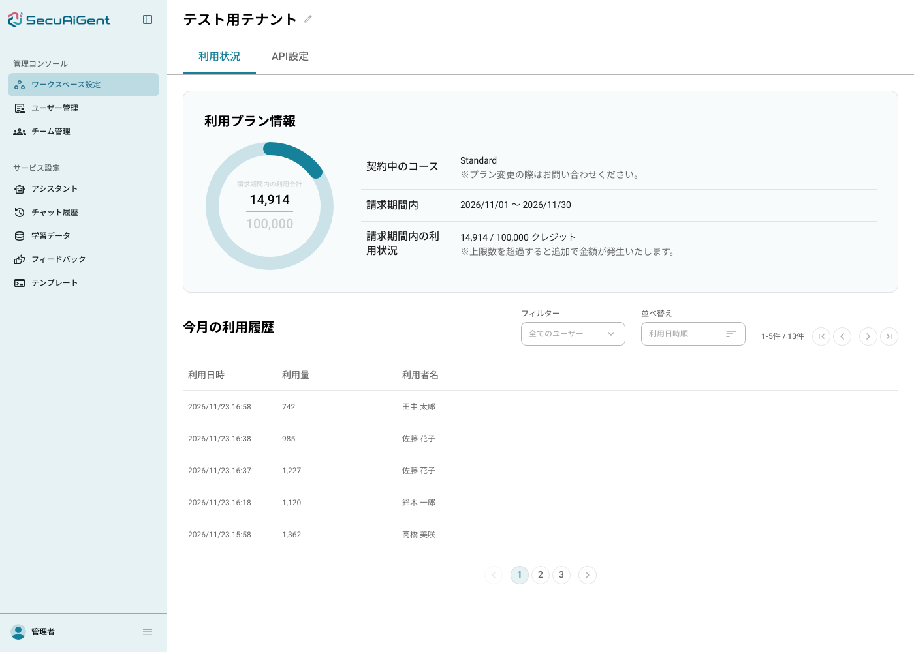
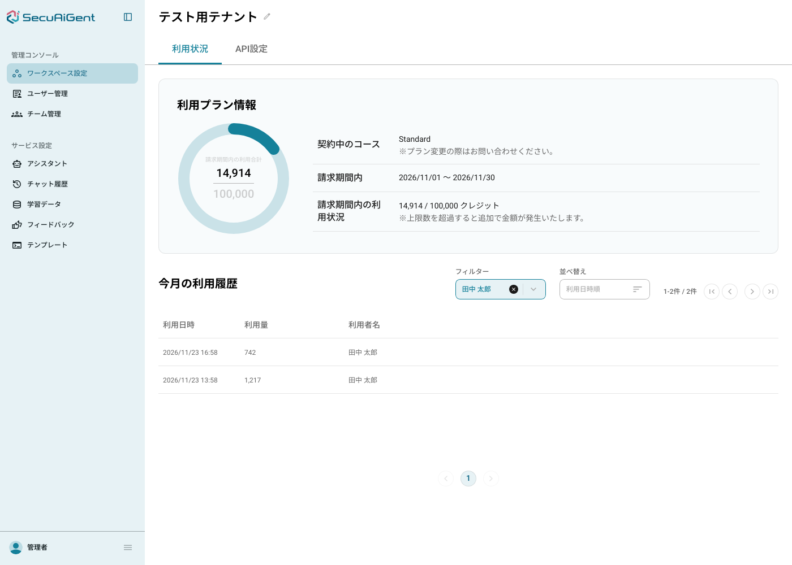

# 08_動作確認

## 確認環境

- ブランチ: `feature/issue-426-NAW-1421`（コミット f5ef675 時点のコード）
- デモ環境: `docker compose -f docker-compose.demo.yml`（`DEMO_FRONTEND_PORT=35173` `DEMO_BACKEND_PORT=38001`）
- ブラウザ: Playwright（ヘッドレス Chromium）。`http://localhost:35173`、テナント `test-tenant`、ユーザー `admin`（デモデータのテスト用ログイン）

## 確認手順

1. ログインして、ワークスペース設定（`/admin/tenant`）の「利用状況」タブを開く
2. 利用履歴の「利用者名」の欄を読む
3. 利用者の絞り込みを開き、「田中」と入力して、選択肢を確かめる
4. 選択肢の「田中 太郎」を選び、利用履歴が絞り込まれることと、API への条件を確かめる
5. この画面を開いている間の、ユーザー一覧 API の呼び出しを記録する

## 確認結果

### Step 1: 利用者名

- 5 行すべてで、API が返す名前（田中 太郎・佐藤 花子・鈴木 一郎・高橋 美咲）が出た。ID や `-` は出なかった

### Step 2: 絞り込み

- 絞り込みに入力すると、「田中」を含む選択肢「田中 太郎」だけに絞られた（検索つきのセレクト）
- 選ぶと、利用履歴の取得に `userId`（田中 太郎のユーザー ID）が付き、2 件に絞り込まれた

### Step 3: ユーザー一覧の取得

- ユーザー一覧 API は `page=0&size=1000&sort=name,asc&includeUsage=false` の 1 回だった（デモのユーザーは 1000 人未満なので、1 ページで総数に達した）

## 未確認事項

- 「SYSTEMユーザー」と「削除されたユーザー」の表示は、デモデータに該当する利用履歴が無いため、ブラウザでは確認していない。画面のテストと単体テストで確かめた
- ユーザーが 1000 人を超えるときの、複数ページの取得は、ブラウザでは確認していない（デモのユーザーが少ないため）。画面のテスト（2 ページ・途中のページの失敗）で確かめた
- 全体テストは、この変更では 136 ファイル 1398 件がすべて通った（別の画面のテストが不安定になることがある #397 の問題は、今回は出なかった）
