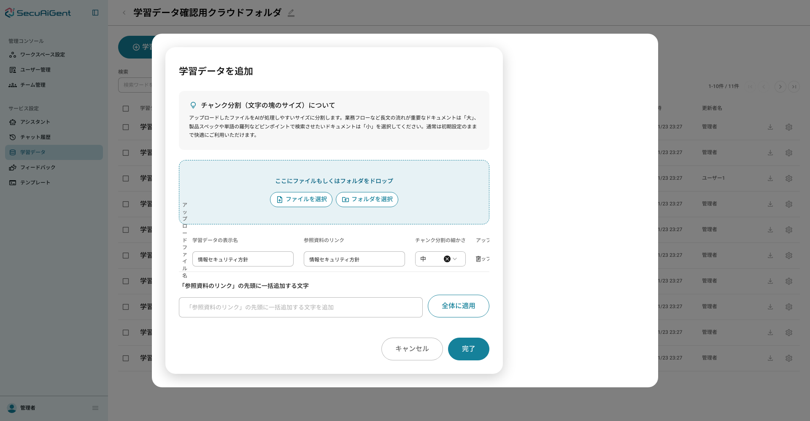
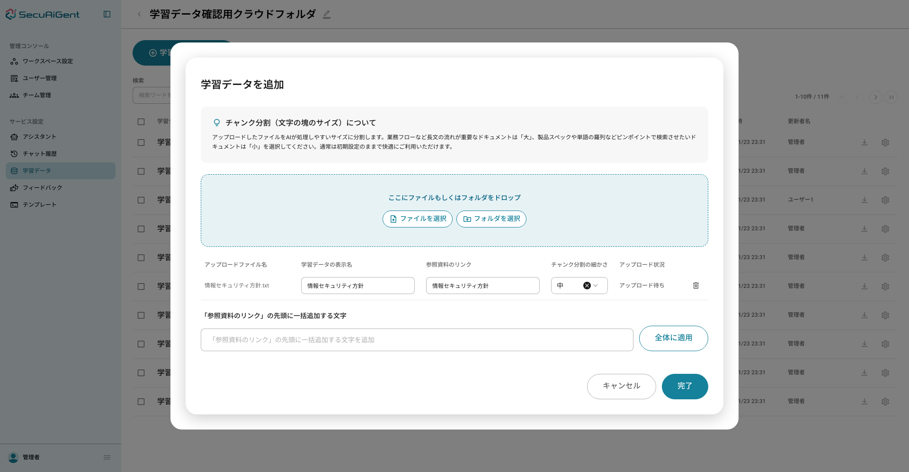
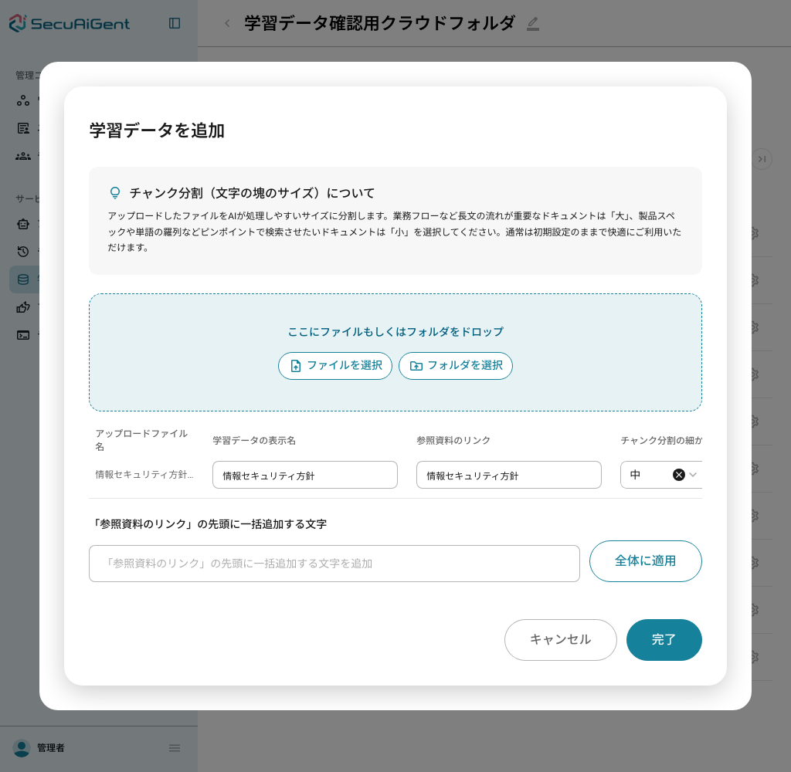

# 08_動作確認

実際に実行して確かめたことだけを書く。確かめていないことは「未確認」に分ける。

## 環境

- 修正前: `develop`（`712ae75`）の専用環境（`naw-e2e-spec`、画面 55273）
- 修正後: worktree の `client/` から起動した専用環境（`naw-e2e-spec-456`、画面 55274・backend 58101）
- 対象: 学習データの「学習データ確認用クラウドフォルダ」→「学習データを追加」→ ファイル `情報セキュリティ方針.txt` を 1 つ選ぶ（管理者 `admin` / `test-tenant`、Chromium、Playwright で自動操作）

## 再現（修正前）

幅 1920px。外枠（surface）1200px、内側のカード（`.modal-content`）**736px**。見出し「アップロードファイル名」の幅 **0px**（縦に積まれ、右の「アップロード状況」が途切れ、削除アイコンが欠ける）。

## 修正後の実測

| ウィンドウ幅 | 外枠 | 内側のカード | `scrollWidth` | 見出し「アップロードファイル名」 |
|---|---|---|---|---|
| 1920px | 1200px | 1072px | 1072px | 180px |
| 1280px | 1152px | 1024px | 1024px | 132px |
| 1024px | 922px | 794px | 952px（横スクロール） | 128px |

- 1920・1280px は、全列がカードに収まる（スクロールなし）。
- 1024px は、全列が収まらないが、ファイル名の列は読める幅を保ち、カード内を横にスクロールして全列に届く（スクロールの操作自体は未実施。`scrollWidth` が幅を超えていることだけを測った）。

## 回帰テスト（e2e-spec の `addFile` の確認）

- 修正（`client/src` の 2 ファイル）を一時的に外して環境を作り直し、`17-28` を実行: 落ちた（`見出し「アップロードファイル名」の幅 / Expected: >= 40 / Received: 0`）
- 修正を戻して作り直し、`17-28`・`17-32` を実行: 2 件通った
- 最初に書いた確認は、幅 0 の見出しが「非表示」と判定され、`toBeVisible` で分かりにくい形で落ちていた。存在の確認（`toBeAttached`）に変えて、幅の確認で落ちるようにした

## 既存のテスト・静的検査

- `client/` で `npx vitest run src/components/features/admin/training-data src/routes/admin/training-data`: 8 ファイル・112 件すべて通った
- `e2e-spec/` で `tests/17-training-data.spec.ts` を修正後の環境に対して実行: 33 件通った・14 件 skip（理由つき。#416・#422）・失敗 0
- `e2e-spec/` の `npm run lint`・`npm run typecheck`、`client/` の変更した `training-data-add-modal.tsx` の `npx eslint`: エラーなし

## code-review 対応後の確認

- 回帰テストのはみ出し確認を、「カードの右端」から「カードの中をスクロールして届く範囲の右端」に変えた（1024px の横スクロールで落ちるため）
- 使い捨てのテストで、修正後の環境に対し、幅 1920・1280・1024px の 3 つで `expectUploadTableFitsDialog()` を実行: 3 件とも通った
- `e2e-spec/` の `npm run lint`・`npm run typecheck`: エラーなし

## 未確認

- **移植元（Angular）で同じ崩れがあるか**: 実機では未確認。CSS（`.modal-dialog` の最大幅 800px、`dialog-xl` が外枠だけを広げること）とマークアップが同一なことは、ソースの比較で確かめた
- Issue に書かれた「ローカルのフォルダ（接続先 `server-local`）」では試していない。クラウドのフォルダで確かめた（追加ダイアログは同じコンポーネントで、フォルダの種類で変わらない）
- 1024px 未満（スマートフォン幅、`max-sm`）は未確認。`md:` 以上だけを変えているので、`max-sm` の挙動は変わらない想定
- e2e-spec の全項目の通し実行は、このブランチではしていない
- 他のダイアログの見た目は目視していない。`dialog-xl` を使うのが追加ダイアログだけであることを、ソースの検索で確かめた
