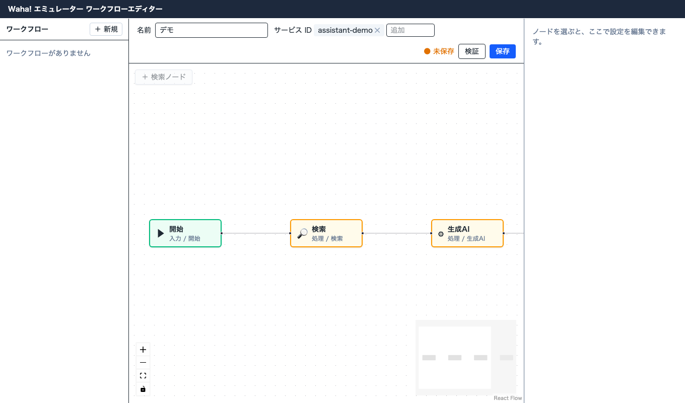
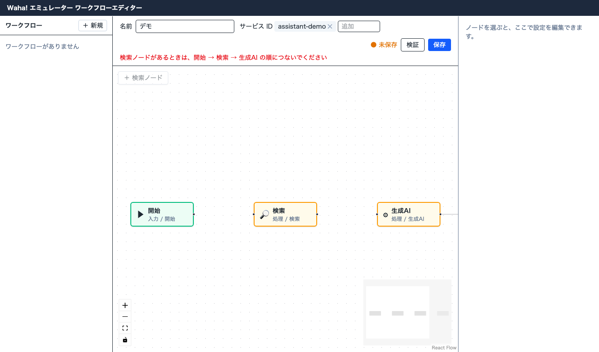
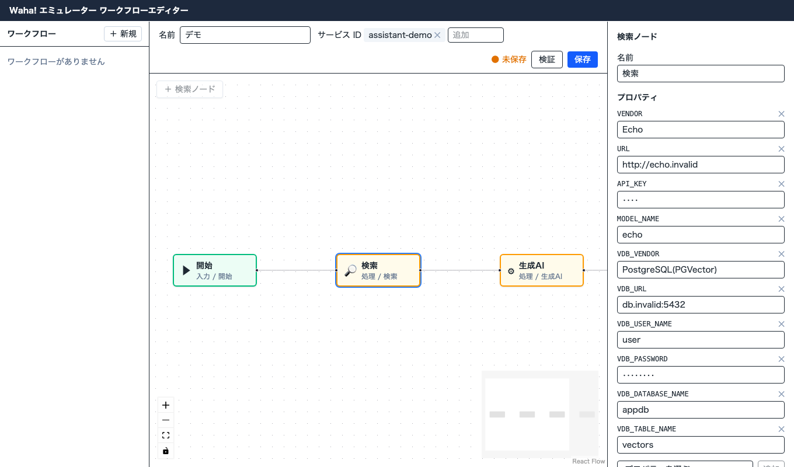
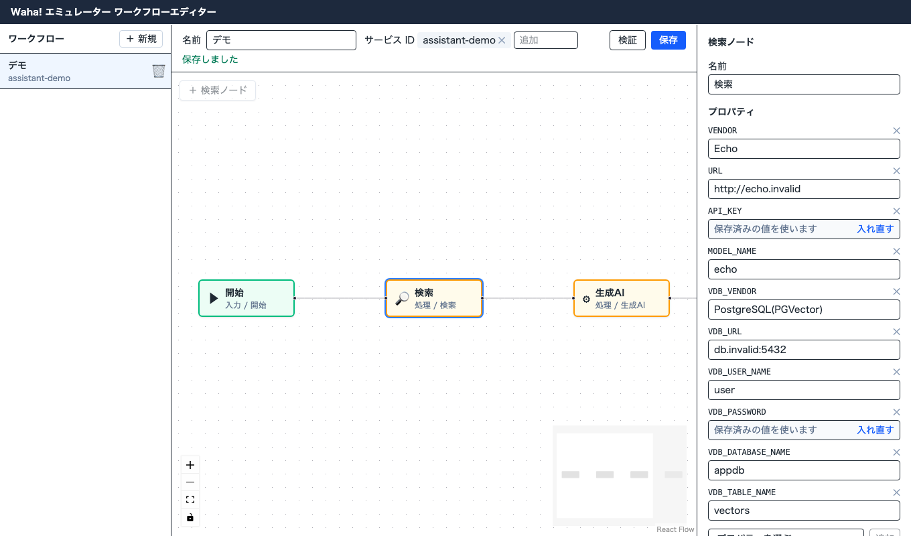
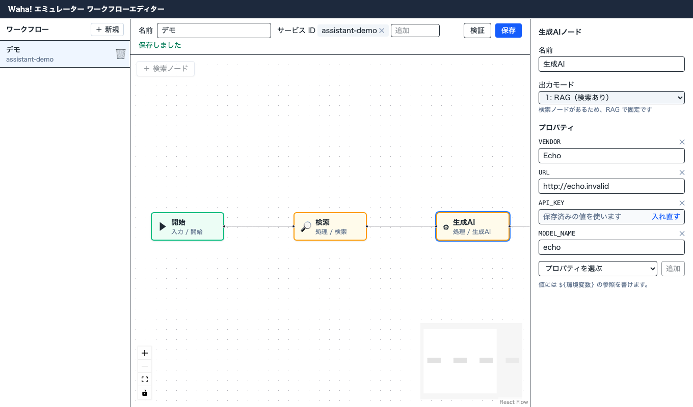

# 08_動作確認

実際に確認した内容だけを書く。

## 自動テスト

### エミュレーター（`waha-emulator/`、`uv run python -m pytest -q`）

```
312 passed
```

既存 309 件に、プロパティ名の候補のテスト 3 件を足した。`ruff`・`mypy` は指摘なし。

### 画面（`waha-emulator/ui/`）

```
npm run lint         指摘なし
npm run type-check   指摘なし
npm test             Test Files 6 passed / Tests 87 passed
npm run build        成功
```

- モデル（変換・線の規則・ノードの追加・未保存の判定）、API クライアント、プロパティ・一覧・ヘッダーの各部品、アプリ全体（開く → 変更 → 保存・エラー・確認・二重保存の防止）を確かめた

## 実ブラウザでの確認

エミュレーター（`WAHA_STUDIO_DIR` を設定）と画面の開発サーバーを起動し、Playwright（Chromium）で操作した。コンソールのエラーは 0 件。

| 手順 | 結果 |
|---|---|
| 画面を開く | 一覧が空で、「左の一覧からワークフローを選ぶか、新規に作成してください」と出る |
| `＋ 新規` で ID・名前・サービス ID を入れて作成 | 開始 → 生成AI → 終了 が開き、`● 未保存` が出る |
| `＋ 検索ノード` | 検索ノードが生成AI の位置に入り、生成AI と終了が右へずれる（重ならない）。`＋ 検索ノード` が押せなくなる |
| 線 開始 → 生成AI を消し、開始 → 生成AI を引き直す | 「検索ノードがあるときは、開始 → 検索 → 生成AI の順につないでください」と出て、線は引かれない |
| 開始 → 検索、検索 → 生成AI を引く | 引ける |
| 検索ノードを選ぶ | 右に名前・プロパティ（VENDOR・URL・VDB_* など）が出る。API キー・パスワードは「保存済みの値を使います」（入れ直す）になる |
| 保存 | 「保存しました」。`● 未保存` が消える。保存先に `demo.json` ができ、ノード・線が入っている |
| 生成AI を選ぶ | 出力モードは「1: RAG（検索あり）」で固定され、選べない。API キーは伏せ字 |
| ページを再読み込みして開き直す | 未保存の印は出ない |
| 保存したファイルを `/admin/workflows/validate` に送る | `{"ok": true}`（画面が送る形が、サーバーの検証を通る） |

スクリーンショット:











## 確認していないこと

- 画面から保存したワークフローを、server-local の execute で動かすこと（第 1 弾の PR #521 で、API 経由の execute は確認済み）
- Windows・Firefox・Safari での表示
- 未保存のまま別のワークフローへ移るときの確認（`window.confirm`）の実ブラウザでの操作。自動テスト（`App.test.tsx`）では確認した
- 画面の見た目の細部（ミニマップ・拡大縮小の操作）。動かして目で見たのは、上のスクリーンショットの範囲
