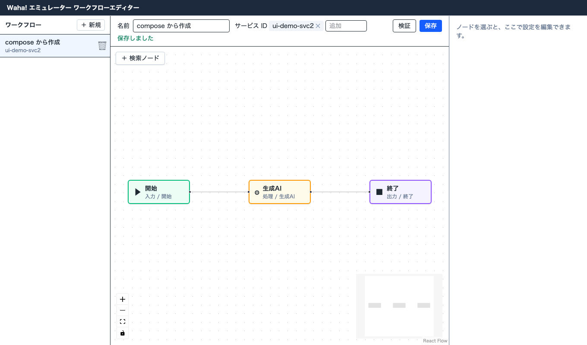

# 08_動作確認

実際に確認した内容だけを書く。今動いている `onprem`（18090〜18091）に触れないよう、別のプロジェクト名（`naw-onprem-524`）・別のポート（28090〜28092）で起動して確認した（ポートだけを変える override ファイルを使った）。確認後は `docker compose down -v` で片付けた。

## compose の起動

`docker compose up -d --build server-local waha-emulator-ui`（`depends_on` で、エミュレーターも起動）

| 確認 | 結果 |
|---|---|
| `docker compose config -q` | 文法・変数の展開に問題なし |
| 3 つのサービスの状態 | server-local・waha-emulator・waha-emulator-ui が、すべて `healthy` |
| 画面のポート | `127.0.0.1:28092->80`（override の値。本来は `127.0.0.1:18092`）。ホストの `127.0.0.1` だけに公開 |

## 中継の範囲

| リクエスト | 結果 |
|---|---|
| `GET /` | 200 `text/html`（画面） |
| `GET /admin/workflows`・`/admin/property-catalog` | 200（エミュレーターに中継された） |
| `GET /WahaServer/servicerun/api/startsession?...` | 200 `text/html`（画面のトップが返る。エミュレーターには中継されない） |
| `GET /some/path` | 200 `text/html`（画面のトップ） |
| キャッシュ | トップは `no-cache`、`/assets/` は `immutable`（長期） |

## 別サイトからの書き込みの拒否（Origin の確認）

| リクエスト | 結果 |
|---|---|
| Origin なしの GET | 200 |
| 画面と同じ Origin の GET | 200 |
| 別の Origin（`http://evil.example`）の GET | 403 |
| 別の Origin の POST（`Content-Type: text/plain`） | 403 |
| 別のポートの Origin（`http://127.0.0.1:3000`）の DELETE | 403 |
| 同じ Origin の DELETE（存在しない ID） | 404（エミュレーターまで届いた） |

## エミュレーターのコンテナを作り直したとき

画面のコンテナを動かしたまま、エミュレーターのコンテナの IP を変えて（ダミーのコンテナで元の IP を塞いでから起動）確かめた。

```
emulator ip: 192.168.164.2 -> 192.168.164.5
UI still running, GET /admin after IP change: 200
```

✅ 中継先を毎回引き直すため、画面を再起動せずに、IP が変わった後も、`/admin` が通った（この設計に直す前の設定は、実機で 502 になることまでは確かめていない。レビューの指摘に基づく対策）。

## 画面で保存 → server-local から呼ぶ

Playwright（Chromium）で、compose の画面（28092）から、ID `ui-demo`・サービス ID `ui-demo-svc` のワークフロー（echo の生成AI）を作成して保存した。コンソールのエラーは 0 件。



保存後、server-local（28090）の `/api/messages/content` を、`assistantId` に `ui-demo-svc` で呼んだ。

```
data:{"type":"text_delta","text":"画面から組みました"}
...
"status":"OK","question":"画面から組みました","answer":"画面から組みました"
```

✅ 画面で保存したワークフローが、再起動なしで、server-local のチャットから動いた。エミュレーターのコンテナ内で、保存ファイルは `app:app`（uid 1000）の持ち主で書かれていた。

## 保存したワークフローの永続（名前つきボリューム）

| 操作 | 結果 |
|---|---|
| `docker compose down` → `up` | 一覧に `ui-demo` が残り、チャット（`ui-demo-svc`）は echo で応答した（`"answer":"後"`） |
| `docker compose down -v` → `up` | 一覧が `[]`（ボリュームごと消えた） |

## 確認の中で気づいたこと

- この環境の `onprem/.env` に `WAHA_WORKFLOWS_FILE`（`/app/onprem-config/workflows.json`）があり、登録のないサービス ID は、その既定の定義（実際の LLM）で動く。確認の途中で、ワークフローを登録せずに呼んだ 3 回の短い質問（「前」「後」「もう一度」）が、この既定の LLM に届いた。画面から保存したワークフロー（echo）の確認とは別。以降の確認は、登録してから呼んだ
- 1 回だけ、`down` → `up` の直後のチャットで、`"answer"` が出力に出なかった（スクリプトの抽出が空）。同じ手順を作り直して 2 回流した結果は、応答が返ったため、原因は確かめられていない（起動直後の 1 回目のみ）

## 確認していないこと

- 今動いている `onprem`（18090〜18092）での起動。この環境の `.env`・既存のボリュームには触れていない
- ベクトルDB（`vector-db`）を含む全部入りの起動。画面とは関係しないため、起動していない
- Firefox・Safari での表示
