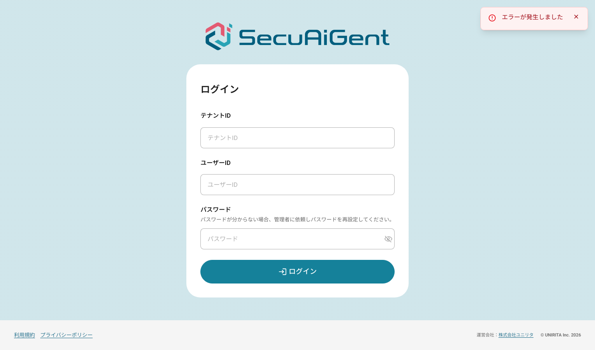
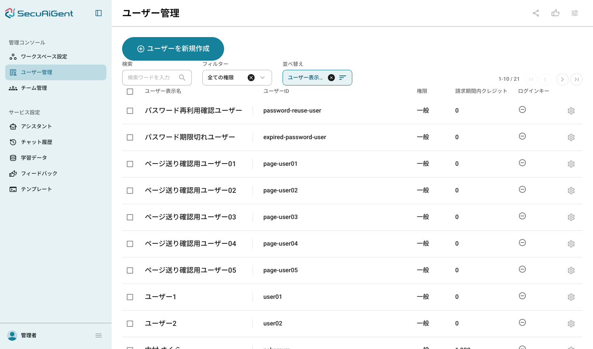

# 08_動作確認

実際に確認した内容だけを書く。今動いている開発のコンテナ（`naw-fastapi-*`）に触れないよう、別のプロジェクト名（`naw-root-528`）・別のポート（画面 28173・backend 28001）で起動して確認した（コンテナ名とポートを上書きする一時の override ファイルを使った）。確認後は `down -v` で片付け、`naw-fastapi-*` が動いたままであることを確認した。

## ルートの compose（`docker compose up -d --build frontend`）

| 確認 | 結果 |
|---|---|
| `docker compose config -q` | 文法・変数の展開に問題なし |
| 状態 | `migrate` が `Exited (0)`、`seed` が `Exited (0)`、`postgres`・`redis`・`localstack`・`backend`・`frontend` が `healthy` |
| ブラウザ（Playwright）で `http://localhost:28173/` のログイン画面から、`test-tenant` / `admin` / `admin@1234` でログイン | `/dashboard` へ遷移。コンソールのエラー 0 件 |
| `/admin/users` | ユーザー管理に、デモデータのユーザー（全 21 名、1 ページ 10 件）が出る |
| 2 回目の `up`（冪等） | `migrate`・`seed` が再び `Exited (0)`。`users` の件数は 51 のまま（seed を単独で流し直しても 51） |

ブラウザの URL を `127.0.0.1` で開くと、CORS の許可オリジン（`http://localhost:<画面のポート>`）と合わず、ログインできなかった（`localhost` では通った）。README の URL は `localhost`。





## e2e-spec の専用環境（自分用の `docker/compose.yml`）

`npm run env:up` でプロジェクト名 `naw-e2e-spec`・画面 55273・API 58100 で起動し、`tests/00-foundation.spec.ts` と `tests/03-login.spec.ts` を実行した。

```
31 passed (19.7s)
```

`npm run typecheck`・`npm run lint` は指摘なし。確認後は `npm run env:down` で片付けた。

（最初の実行では、`environment.ts` の編集で `-f` が 1 つ余り、`env:up` が失敗した。直して、上の結果を得た）

## backend の公開範囲

レビューの指摘で、backend のポートを、既定でホストの `127.0.0.1` だけにした（`BACKEND_HOST` で変える）。`docker compose config` で、`host_ip` が backend・画面とも `127.0.0.1`、`BACKEND_HOST=0.0.0.0` では `0.0.0.0` になることを確認した。

`127.0.0.1` だけに公開したポートに、別のコンテナから `host.docker.internal` 経由で届くか（onprem の server-local が、ルートの backend の 8001 を呼ぶため）を、別のポートで確かめた。

```
from onprem server-local container -> host.docker.internal:28999 (published on 127.0.0.1 only): 200
```

## 確認していないこと

- 今動いている開発の環境（`naw-fastapi-*`）での `docker compose up`。コンテナの作り直し・ボリュームの引き継ぎは確認していない（既存のボリュームの名前・コンテナ名・ポートは変えていない）
- e2e-spec の全 21 ファイル（確認は 2 ファイル 31 件。環境の起動と、ログインの流れ）
- Linux の Docker での、`127.0.0.1` だけに公開したポートへの `host.docker.internal` 経由の接続（この確認は Docker Desktop（macOS）。届かないときの `BACKEND_HOST=0.0.0.0` を `.env.example` に書いた）
- `onprem/` の通し（クラウド側の backend を、この新しい compose で立ち上げての接続）
